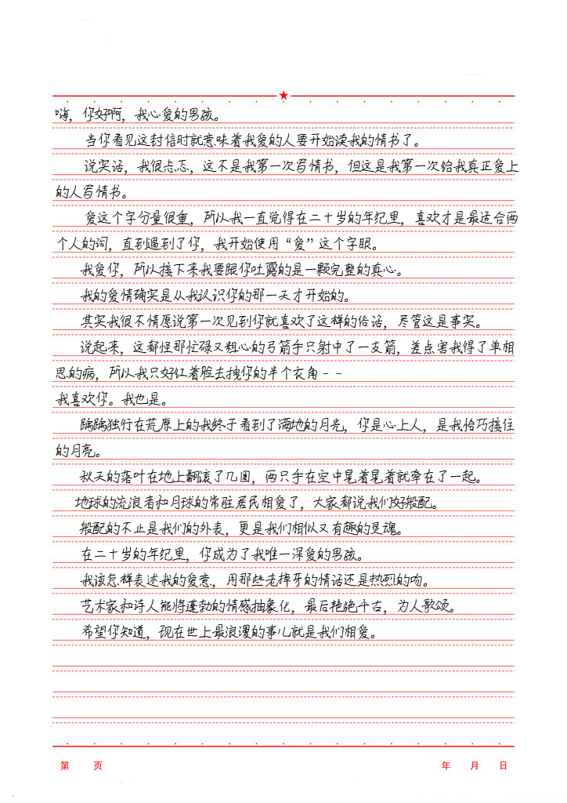

# 星笺

**让文字，带一点星光。**

把想说的话，写成一页有温度的纸笺。星笺是一款本地手写图片生成器，将文字化作手写模样，陪你写一封信、留一段诗，也收藏日常里微小而明亮的心事。

选一张喜欢的纸，挑一种合心意的笔迹，再慢慢调整字句之间的距离。星笺提供实时预览、字体与纸张选择、墨色和排版调整，让一句问候、一段摘抄或一篇日记，成为可以保存、分享的图片。喜欢的排版也能存成预设，留给下一次落笔。

文字和图像处理均在本地完成，无需 API Key。仓库提供纯 Rust 原生版和 Python / PyQt6 版，每个版本的 GUI、CLI 和本地 MCP 共用各自的渲染核心。仓库与开发工具继续使用 `HandwritingGenerator` / `handwriting-generator` 标识。



## 新项目：星笺 Starclip

我们正在开发 [星笺 Starclip](https://github.com/cpython666/starclip)，将剪贴历史、搜索、星标分组、代码收藏和图片卡片制作整合到一个本地工作台中。

Starclip 的「星绘坊 → 月光笺」已接入本项目的手写图片生成功能：可将文字或剪贴记录制作成手写纸笺，选择内置字体与纸张，调整字号、墨色和留白，自动预览并导出 PNG。

目前通过本地 CLI 复用本仓库的 Rust 渲染器。先安装或构建下方的 Rust 版，再在 Starclip 中选择星笺应用；Starclip 安装包尚未捆绑渲染器和字体。需要直接拖字定位、复制图片或完整排版预设时，可继续使用本项目的独立编辑器。

详细用法见 [Starclip 星绘坊说明](https://github.com/cpython666/starclip#星绘坊)。早期 `v0.1.0-alpha.1` 发布包尚不包含星绘坊，请以当前源码说明为准。

## 纯 Rust 原生版

`rust/` 目录中的 [Rust 版](rust/README.md) 使用 egui/eframe 原生桌面界面，完整内置 9 款字体和纸张，无需 Python、Qt 或 WebView，支持 macOS / Windows 构建。

- 直接拖动预览中的文字，位置参数双向同步；也可输入数值精确定位。
- 纸张与文字分层缓存，连续调整字号、字距等参数时持续更新预览。
- 导出 PNG / JPEG / WebP，或点击「复制为图片」复制原尺寸图片（`⌘/Ctrl + Shift + C`）。
- 同一个程序提供桌面、CLI 和本地 MCP，完整字体无损压缩后嵌入，可离线使用。

```sh
cargo run --manifest-path rust/Cargo.toml --release --locked
```

构建要求、打包、CLI / MCP 配置和平台验证范围见 [Rust 使用说明](rust/README.md)。以下章节介绍保留的 Python / PyQt6 版。

## Python 版快速开始

macOS 和 Windows 使用相同源码，需要 Python 3.10+（开发与打包推荐 3.12）。推荐使用 [uv](https://docs.astral.sh/uv/getting-started/installation/) 管理独立环境与锁定依赖。以下两条命令在终端和 Windows PowerShell 中均可使用：

```bash
uv sync
uv run python main.py
```

也可使用已有 Python，按操作系统选择启动命令，无需修改 PowerShell 执行策略：

```bash
python -m venv .venv
# macOS / Linux
.venv/bin/python -m pip install 'PyQt6>=6.7,<7'
.venv/bin/python main.py
# Windows PowerShell
.venv\Scripts\python.exe -m pip install 'PyQt6>=6.7,<7'
.venv\Scripts\python.exe main.py
```

内置字体、背景和图标按程序所在目录定位，从其他目录启动也可使用。源码目录需要保留 `fonts/`、`bgs/`、`icons/` 和 `logo.png`。

## 桌面使用

- 窗口与顶部品牌区显示「星笺」及标语「让文字，带一点星光。」；点击「关于星笺」可阅读产品介绍。
- 顶部固定显示预设与导出操作；左侧分为「内容 / 排版 / 纸张」，可拖动中间分隔条调整画布空间。
- 统一浅色界面，使用系统 UI 字体；Qt 6 自动适配 Retina 与 Windows 显示缩放，文件选择仍使用系统原生对话框。
- 输入文字，选择背景、内置字体或导入 TTF / OTF / TTC 字体。
- 调整边距、文字区域、字号、字重、字距、行距和墨色。输入与滑块更新有 120 ms 防抖。
- 保存 / 打开 JSON 预设，保留文字、资源路径和排版参数。
- 拖动预览移动纸张，Windows Ctrl / macOS ⌘ + 滚轮缩放，触控板按滚动增量平滑调整。工具栏支持缩小、放大、1:1 和“适应”；适应模式会随窗口大小变化，手动缩放则保持倍率。
- “文字边界”可显示实际裁切区域，边界线只用于预览。纸张标签可直接切换内置背景并查看缩略图。
- 右键拖动显示坐标和尺寸，双击移除。测量标记不会进入导出图片。
- 点击导出或按 Ctrl / ⌘ + S，选择 PNG、JPEG 或 WebP。纯色背景也可直接创建并使用。

快捷键跟随操作系统：Ctrl / ⌘ + O 打开预设，Ctrl / ⌘ + Shift + S 保存预设，Ctrl / ⌘ + S 导出，Ctrl / ⌘ + W 关闭窗口。按钮提示会显示本机实际按键。

导出保持背景原始像素尺寸，**超出文字区域的内容会裁切**，不会自动分页。长文可增大文字区域、减小字号或分成多张。文字按纯文本处理，`< > &`、空格与换行不会解释成 HTML。PNG 可保留透明背景。

## CLI

```bash
# 列出内置资源（JSON）
uv run python cli.py assets

# 直接生成
uv run python cli.py render --text '你好，世界！' --output outputs/hello.png

# 从 UTF-8 文件生成，同时保存预设
uv run python cli.py render --text-file letter.txt --font 'fonts/hand.ttf' --background bgs/letter.png --font-size 24 --color '#24324a' --x 80 --y 80 --width 560 --height 850 --letter-spacing 0.1 --line-spacing 1.4 --output outputs/letter.png --save-preset outputs/letter.json

# 复用排版，替换文字
uv run python cli.py render --preset outputs/letter.json --text '新的一封信' --output outputs/next.png

# 完整帮助；--text-file - 可读取标准输入
uv run python cli.py render --help
```

命令行参数覆盖预设。默认拒绝覆盖已有图片或预设，显式加 `--force` 才允许。成功时输出包含路径、宽高的 JSON，失败时在 stderr 输出原因并返回非零状态。输出目录自动创建。

字号单位为 pt（固定 96 DPI 排版），坐标和区域宽高为 px；字距是附加的 em，行距是倍数。JSON 预设字段与 `rendering.RenderConfig` 一致，保存时优先使用相对于预设目录的资源路径（跨 Windows 盘符时使用绝对路径）。移动预设时应一并保留对应资源的相对位置，或重新选择资源。

## 本地 MCP（可选）

需要让 AI 工具直接调用生成器时，再启用这部分依赖：

```bash
uv sync --extra mcp
uv run --extra mcp python mcp_server.py --output-dir outputs
```

这是 stdio 服务，启动后等待 MCP 客户端输入。它提供：

| 工具 | 用途 |
| --- | --- |
| `list_assets()` | 查询内置字体、背景和允许的输出目录 |
| `render_handwriting(text, output_path, preset_path?, options?, overwrite?)` | 本地生成图片，返回路径与宽高 |

`options` 使用 `RenderConfig` 字段，例如 `{"font_size": 28, "rect_width": 560, "font_color": "#24324a"}`。输出路径相对于 `--output-dir`，默认是项目的 `outputs/`；只能向该目录内写图片，默认不覆盖。字体、背景、预设可读取本地路径。没有 HTTP 监听端口，也不会上传正文或图片。

Codex 可以在项目 `.codex/config.toml` 中配置本地服务，填入本机的实际绝对路径：

```toml
[mcp_servers.handwriting]
command = "/absolute/path/to/uv"
args = ["run", "--frozen", "--extra", "mcp", "python", "mcp_server.py"]
cwd = "/absolute/path/to/HandwritingGenerator"
startup_timeout_sec = 30
```

此本机配置已加入 Git 忽略规则。在 Codex 信任该项目并重启 MCP 连接后使用；可用 `codex mcp get handwriting` 查看配置。项目级配置方式见 [Codex MCP 文档](https://learn.chatgpt.com/docs/extend/mcp?surface=cli)。

## 项目 skill

`.agents/skills/handwriting-generator/SKILL.md` 包含资源选择、CLI / MCP 生成流程、预设复用和项目修改要点。在 Codex 中可用 `$handwriting-generator` 调用，例如：

> 用 $handwriting-generator 把这段文字生成钢笔手写图片，保存到 outputs，并留下可复用的预设。

采用官方支持的[仓库级 skill 目录](https://learn.chatgpt.com/docs/build-skills)。`AGENTS.md` 提供精简的开发入口与检查命令。

## 开发与检查

```bash
uv sync --frozen --extra mcp
uv run --no-sync python -m unittest discover -s tests -v
uv run --no-sync ruff check .
uv run --no-sync ruff format --check .
```

测试使用 Qt offscreen 模式，覆盖实际图片渲染、区域裁切、纯文本、无效输入、跨目录运行、预设往返、桌面导出和真实 MCP stdio 调用。未安装可选 MCP 依赖时，对应测试会跳过。

- `rendering.py`：共享排版、缓存、校验、预设和原子保存。
- `main.py`：桌面编辑器；`ui_style.py`：跨平台主题；`cli.py`：命令行；`mcp_server.py`：可选 MCP 适配。
- `tests/`：回归测试；`test/`：历史本地实验，未纳入检查。
- `uv.lock`：已验证的依赖版本；`outputs/`：忽略的生成文件目录。

图片单边最多 8192 px，总计最多 3200 万像素，正文最多 10 万字符。字体缓存最多 16 项、背景缓存最多 2 项；同一路径文件修改后会重新加载。

## macOS / Windows 打包

在目标操作系统上运行同一套命令；[PyInstaller 需要在目标系统构建](https://pyinstaller.org/en/stable/operating-mode.html)：

```bash
uv sync --frozen --group build
uv run --no-sync pyinstaller main.spec
```

`build` 依赖组仅用于打包，包含 PyInstaller 和负责平台图标转换的 Pillow。产物已包含 Python、Qt、字体、纸张和图标，使用者无需单独安装 Python：

| 系统 | 打开方式 |
| --- | --- |
| macOS | 双击 `dist/星笺.app` |
| Windows | 打开 `dist/星笺/星笺.exe`；分发时保留整个目录 |

macOS 产物对应构建机器的 CPU 架构；目前不生成跨架构 universal 应用，也未做 Developer ID 签名或公证。

`.github/workflows/check.yml` 在 macOS 和 Windows runner 上安装锁定依赖，执行静态检查、无界面回归测试和打包，再提供带系统与架构名称的下载归档。macOS 用 tar 保留应用可执行权限与符号链接。可在 GitHub Actions 手动触发，也会在主分支、`codex/pure-rust` 分支推送与 PR 时运行。

当前开发机可实际验证 macOS；Windows 是否通过需以对应 Actions 运行结果和目标机器测试为准。
